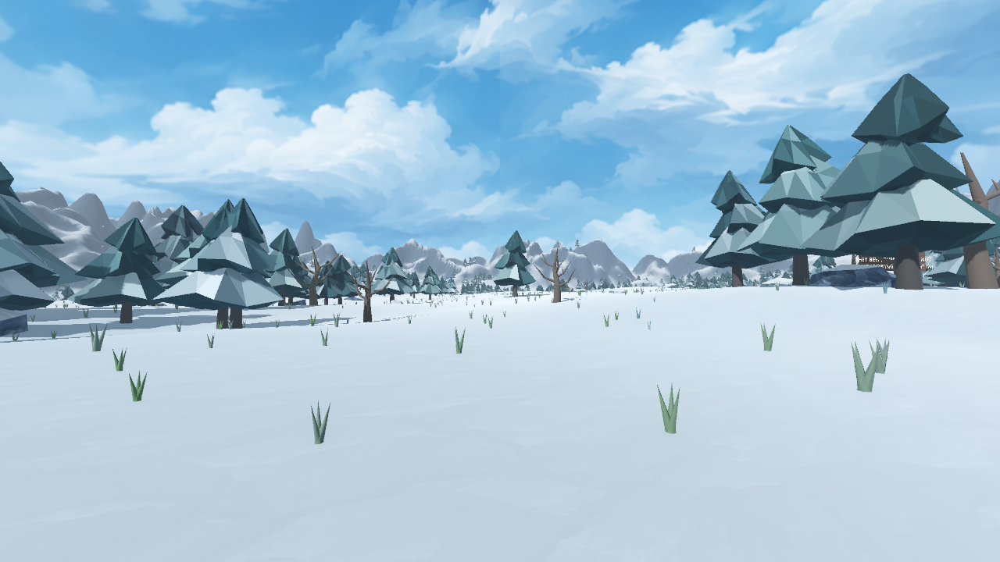
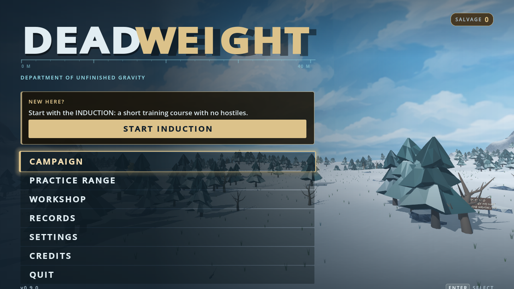
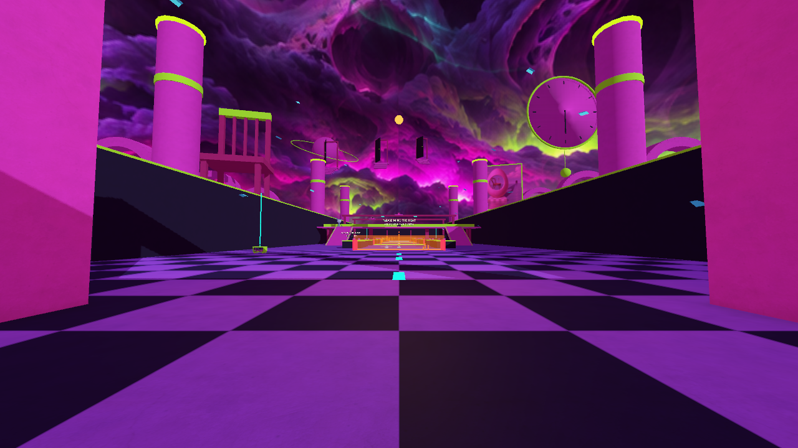

# The Department of Unfinished Gravity

An owner-directed visual revision for DEADWEIGHT, 2026-11-03 to 2026-11-04.



## Research and interpretation

Absurdism is not one historical painting style. Camus locates the absurd in the
confrontation between our desire for intelligibility and a world that offers no final
answer. Lucidity, continuing to act, and lived experience matter to his response.
This suggested a world of official structures whose purpose has slipped away, with
the player's joyful movement as a response to the burden they carry.
[Stanford Encyclopedia of Philosophy: Albert Camus](https://plato.stanford.edu/entries/camus/)

Surrealism supplies a related visual language, rather than being interchangeable
with that philosophy. Dream associations, displaced ordinary objects and irrational
combinations can make familiar surroundings uncertain. The V&A's account of surrealist
objects and stage design informed the use of furniture as landscape and the level as
a theatrical space. The Met's history connects surrealism with Dada and its rejection
of conventional reason. These are references for methods, not paintings to reproduce.
[V&A: Surrealism and design](https://www.vam.ac.uk/articles/surrealism-and-design),
[The Met: Surrealism](https://www.metmuseum.org/essays/surrealism)

The absurd objectives and official rituals can inhabit a grounded world. The owner's
final direction makes cold, snowy mountains the baseline and assigns the more extreme
palettes to particular campaign regions. An impossible task in a recognisable landscape
can carry the absurd without turning every tree and floor into a hallucination.

The environment reference is chunky, painted fantasy scenery. The emphasis is on
silhouette, terrain composition and material variation. Blizzard exterior level designer
Sarah Boulian Verrall describes terrain sculpting, painting and placed props as parts of
that work in her [Stormsong Valley breakdown](https://sboulian.artstation.com/projects/y9Jq3).
Our textures and meshes are original; no Warcraft assets were imported.

## Campaign direction

| Region | Sky and palette | Use |
| --- | --- | --- |
| Floodworks | Cold blue sky, snow, slate, weathered brass | Tutorial, raids 01-03 and practice range |
| Highlands | Cold blue sky, snowfields, frozen lakes, dark evergreens | Main-menu backdrop, valley and princess raid |
| Foundry | Animated violet nightmare sky, magenta, lime and cyan | Raids 04-06; impossible furniture and clocks |
| Spillway | Painted afternoon, celadon, stone and muted rose | Prepared for the later catalog entries, whose level scripts are not yet present |

The shared UI and tools use restrained slate-blue, pale metal and brass. The neon
palette is no longer applied to the whole game. The rejected zigzag lightning has
been removed from the shader entirely.

## Geometry and materials

- New generated cold-sky panorama and painted slate material, both mipmapped.
- Compact opening levels sit inside real irregular mountain ridges, with matching terrain colliders.
- The highlands have wind-scoured snow, exposed slate faces and icy-blue lakes.
- Pines have unequal layered boughs, bent centres, notched edges and painted snow cover.
- Broadleaf trees are bare winter branches rather than spherical canopies.
- Boulders have fractured, asymmetric outlines and flattened ledges instead of sphere primitives.
- Short stone blocks have unequal chamfers; their collision hulls follow those surfaces.
- Terrain and rock materials blend slate and snow according to surface orientation.

The main-menu camera now overlooks the snowy valley. Campaign ordering, mission
objectives, controls and saves are unchanged. The new mountain surroundings remain
outside the existing route navmeshes; trees and boulders still use the established
navigation exclusions and obstacle posts.

### V2b additions (lead, 2026-11-04)

- Sheltered hollows in the highlands thaw to muted turf and heather with ragged edges. Grass
  tufts and small alpine flowers grow only there, never out of a snowfield.
- Light snowfall in the alpine zones, as soft round flakes carried along with the camera. It is
  off on Low quality.
- Solid pine groves stand on the snow between the compact works and their mountain ridges.
- Tree and rock batches are split into 350 m cells so culling and shadow cascades skip what is
  out of view. The terrain no longer casts sun shadows.

## Moving skies

Every region uses its own panorama with a level-local clock. Cold skies drift slowly.
Foundry clouds move faster, with a counter-moving veil and distant expanding cloud
glows. These are visual atmosphere, not damaging explosions. There is no lightning.
Animation pauses with gameplay, resumes on unpause and starts fresh with a new level.
The cubemap branch uses a cheap static sample to keep reflections stable. The shader
follows [Godot's sky shader reference](https://docs.godotengine.org/en/stable/tutorials/shaders/shader_reference/sky_shader.html).

## Assets

| Saved asset | Consumption |
| --- | --- |
| [`alpine_sky.png`](../assets/dreamscape/alpine_sky.png) | Cold starting areas and highlands |
| [`alpine_slate.png`](../assets/dreamscape/alpine_slate.png) | Painted stone, mountains and snow blending |
| [`nightmare_sky.png`](../assets/dreamscape/nightmare_sky.png) | Foundry sky and the magical suitcase windows |
| [`afternoon_sky.png`](../assets/dreamscape/afternoon_sky.png) | Spillway's prepared sky |
| [`porcelain.png`](../assets/dreamscape/porcelain.png) | Ceramic detail in surreal regions, enemies and equipment |
| [`vacant_chair.png`](../assets/dreamscape/vacant_chair.png) | Framed mural in surreal regions |

The built-in image generation tool created these textures. The project-local PNGs
are unchanged copies of its outputs. [Exact prompts](../assets/dreamscape/PROMPTS.md)
are retained. Models are generated in GDScript; painted textures complement real geometry.

## Validation and reproduction

Off-screen capture tools do not load or write the player's profile:

```powershell
& '.tools/godot/Godot_v4.7.2-stable_win64_console.exe' --path . --position 20000,20000 --resolution 1280x720 --script res://tests/level_preview.gd -- --level=valley
& '.tools/godot/Godot_v4.7.2-stable_win64_console.exe' --path . --position 20000,20000 --resolution 1280x720 --script res://tests/level_preview.gd -- --level=l04
& '.tools/godot/Godot_v4.7.2-stable_win64_console.exe' --path . --position 20000,20000 --resolution 800x450 --script res://tests/storm_preview.gd
```

Add `--rendering-method gl_compatibility` for the mobile rendering path. Storm preview
records the Foundry at 15 fps; `--start=<seconds> --frames=<count> --out=<folder>` can
capture a short section. [Animated Foundry preview](images/nightmare-storm.gif).

Validation: **69 scripts parsed; all 12 headless suites passed**. World integration
checks include 125 assertions, including matching mountain geometry/collision and
keeping it outside the route navigation bake. The dream animation tests now use
Foundry levels; the title-flow check expects the snowy valley. Sky pause/resume and
independent level clocks pass. Forward+ and Compatibility captures were reviewed.
The title capture used a disposable `.tools` profile, never the player's save.

Final Compatibility valley capture: 49 draw calls / 2,492,196 rendered triangles at
the spawn camera on the desktop GPU. This includes shadow rendering; it is not a
physical Android frame-rate measurement. The nature meshes stay in MultiMesh batches.



