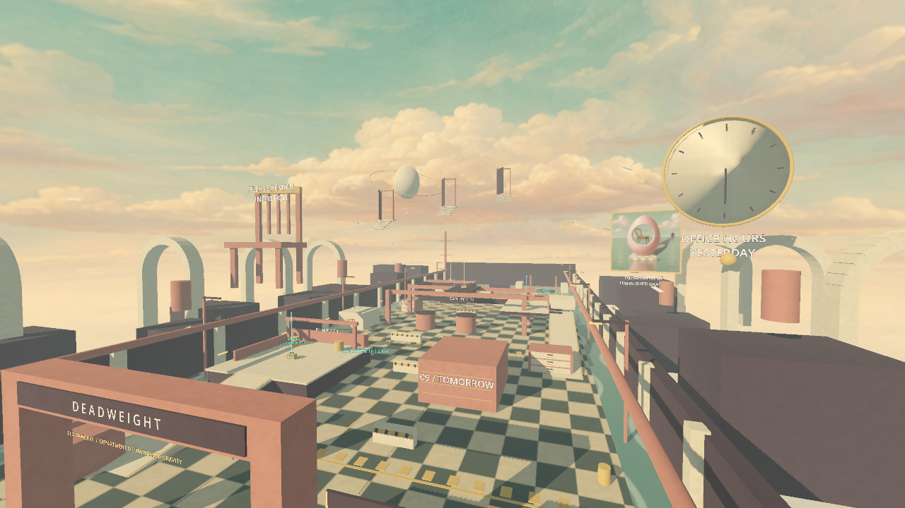
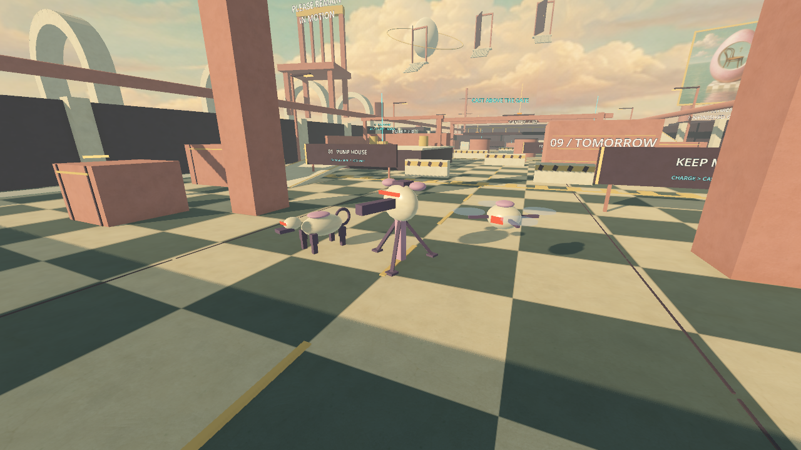

# The Department of Unfinished Gravity

An owner-directed visual revision for DEADWEIGHT, 2026-11-03.



## Research and interpretation

Absurdism is not one historical painting style. Camus locates the absurd in the
confrontation between our desire for intelligibility and a world that offers no final
answer. Lucidity, continuing to act, and lived experience matter to his response.
This suggested a world of official structures whose purpose has slipped away, with
the player's joyful movement as a response to the burden they carry.
[Stanford Encyclopedia of Philosophy: Albert Camus](https://plato.stanford.edu/entries/camus/)

Surrealism supplies a related visual language, rather than being interchangeable
with that philosophy. Dream associations, displaced ordinary objects and irrational
combinations can make familiar surroundings uncertain. The V&A's account of surrealist
objects and stage design informed the use of furniture as landscape and the level as
a theatrical space. The Met's history connects surrealism with Dada and its rejection
of conventional reason. These are references for methods, not paintings to reproduce.
[V&A: Surrealism and design](https://www.vam.ac.uk/articles/surrealism-and-design),
[The Met: Surrealism](https://www.metmuseum.org/essays/surrealism)

The resulting interpretation is quiet, solemn and faintly comic. A chair holds an
office nobody occupies. A clock points downward and announces yesterday. Doors offer
thresholds without destinations. The weight that should stop you is what lets you fly.
These are our invented motifs, not claims about what Camus prescribed for visual art.

## In the game

- Painted celadon and apricot sky, light atmospheric haze, long architectural shadows.
- Ivory ceramic checker floors with derivative filtering to reduce distant shimmer.
- Generated porcelain patina on architecture, enemies, tools and the cast weight.
- Dusty rose structures and plum shade; brass and green remain functional accents.
- Giant empty chairs, freestanding arcades, floating doorsteps, an egg with a ring,
  a useless pendulum clock, and an original generated mural of a vacant chair.
- Porcelain tea hounds, alarm-clock sentries, ceramic drones and an elongated ceramic
  cast weight. Existing animation pivots, enemy tells and physics shapes are retained.
- Menus adopt warm paper, plum and celadon with the department's title-screen subtitle.

The shared level builder applies this direction to both available environments, Sluice
Gate and Practice Range. The other catalog entries are still placeholders. Their zone
palettes are prepared, but those unbuilt levels have not been visually validated.
Traversal geometry, objective positions, progression, controls and save formats stay intact.

## Assets and implementation

The built-in image generation tool produced three assets; no API/CLI fallback was used.
Files are project-local and have mipmaps enabled in their Godot import configurations.

| Saved asset | Consumption |
| --- | --- |
| [`afternoon_sky.png`](../assets/dreamscape/afternoon_sky.png) | PanoramaSkyMaterial |
| [`porcelain.png`](../assets/dreamscape/porcelain.png) | Shared ceramic material detail |
| [`vacant_chair.png`](../assets/dreamscape/vacant_chair.png) | Framed world mural |

[Exact generation prompts](../assets/dreamscape/PROMPTS.md) are retained for revision.
`scripts/dreamscape.gd` builds the new 3D scenery with the existing material batches.
`shaders/dream_floor.gdshader` combines the generated material with a world-space checker.
These are actual game resources, not concept art displayed in place of a working level.

## Validation and reproduction

The off-screen capture tool does not load or write a profile:

```powershell
& '.tools/godot/Godot_v4.7.2-stable_win64_console.exe' --path . --position 20000,20000 --resolution 1280x720 --script res://tests/dreamscape_preview.gd
```

Add `--rendering-method gl_compatibility` for the mobile rendering path. Captures go to
`.tools/captures/dreamscape/`, with the renderer in each filename. Spawn views, an overview,
and an enemy lineup are captured. The title screen can be checked with `tests/ui_preview.gd`.

Rendered Compatibility validation at 1280 x 720 measured 155 draw calls / 23,366 scene
triangles for Sluice Gate and 62 / 8,810 for Practice Range at the test's spawn cameras.
These are desktop GPU observations, not a physical Android performance certification;
other viewpoints and active effects can cost more. Both levels passed the 65 placement,
navigation, catalog, label and light checks. Only one sun is added by the art pass.

The full quality gate is `powershell -ExecutionPolicy Bypass -File tests/run_all.ps1`.
Final result: **48 scripts parsed, all nine suites passed, QUALITY GATE: PASSED**.
Forward+ and Compatibility captures were visually inspected. Checker edges use
derivative filtering and fade at subpixel sizes. Title preview reported zero problems.
During validation, existing drone fixtures were corrected to use arena-local coordinates
and place flying drones in their hover band; the double arena offset had prevented the
tests from exercising shots and blast damage. Gameplay damage assertions were retained.


